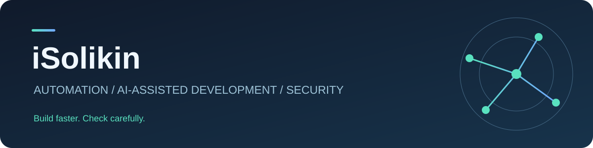

# Solikin

Создаём ботов и скрипты для задач, которые надоело делать вручную. Нейросети ускоряют разработку, а проверка надёжности и безопасности остаётся отдельным этапом работы.

Работаем с браузерными расширениями, Python, JavaScript и панелями мониторинга. Поддерживаем проекты после запуска.

## Проекты

| Проект | Задача | Формат |
| --- | --- | --- |
| [AFK Heroes Bot](https://github.com/iSolikin/afk-heroes-bot) | Игровые действия, инвентарь и маркет | Расширение Chrome / Edge |
| [Farm Ricochet Market Bot](https://github.com/iSolikin/farm-ricochet-market-bot) | Анализ цен и управление лотами | Расширение браузера |
| [Stonewatch Keep Bot](https://github.com/iSolikin/stonewatch-keep-bot) | Сбор, строительство и развитие | Расширение Chrome |
| [Tharkira Bot](https://github.com/iSolikin/tharkira-bot) | Бои, развитие героев и контроль вкладки | Расширение Chrome |
| [XNOVA Auto Builder](https://github.com/iSolikin/xnova-auto-builder) | Планирование ресурсов и развитие аккаунта | Расширение Chrome |
| [Bot Dashboard](https://github.com/iSolikin/bot-dashboard) | Наблюдение за работой нескольких ботов | Локальная панель |
| [Pixels Bot](https://github.com/iSolikin/pixels-bot) | Прототип автоматизации действий в браузере | Python / Playwright |

## Есть задача для автоматизации?

[Напишите @isolikin](https://t.me/isolikin): расскажите, что хотите автоматизировать, или назовите проект из портфолио. Подберём формат работы и условия доступа.
